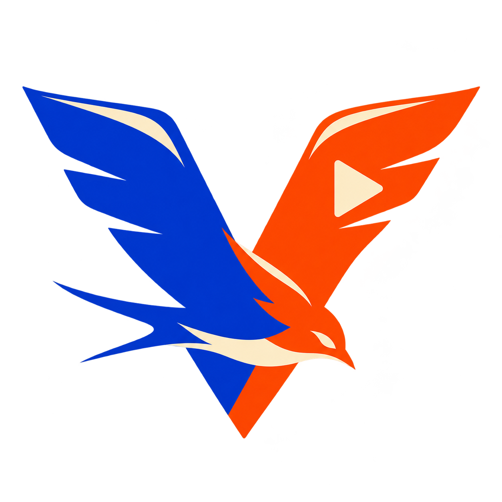

  

<h1 align="center">Veldon Game</h1>

<a href="README.md" lang="zh-CN">简体中文</a> · <strong>English</strong>

## Contents

- [About and vision](#en-vision)
- [Weekly game updates](#en-updates)
- [Platform roadmap](#en-roadmap)
- [Join the discussion](#en-discuss)
- [Copyright and credits](#en-rights)

**Repository directories**　[Weekly progress](progress/) · [Logo assets](assets/)

## About and vision

**Our first goal is to make 1,000 original games with AI as a tribute to the games we grew up playing.** We remember sharing a screen, losing a round, and passing the controller to a friend for one more try. We want to make new games that earn that extra round. Each one starts with a rule we can put in someone’s hands and see whether it’s fun.

Over time, we want to put the tools and lessons from those 1,000 games in everyone’s hands. Veldon Game will be a place to **generate games with AI, publish them, play them, and meet people who share your interests**. A player who suggests a new rule today could build it tomorrow and send it to a friend.

A local studio prototype already lets creators browse design documents, code, and assets and preview a game in a browser. The hosted studio, public arcade, and on-site community are planned.

## Weekly game updates

**Each week, we aim to release or update at least one game.** The log records the game number, what changed, and where to play. A title counts toward the 1,000 when it first joins the collection. Later versions keep the same number.

[Browse the weekly game log →](progress/README.md)

## Platform roadmap

| Feature | What you’ll be able to do |
| --- | --- |
| Generate games with AI | Describe a rule, use AI to build a playable first level, then tune the rules, code, and assets as you play. |
| Publish games | Give a playable version its own shareable link. Friends can keep playing after the creator closes the studio. |
| Play games | Browse the arcade by genre or player count, jump into a game, and send a favorite to a friend. |
| Community for players and creators | Leave playtest notes on a game’s page, discuss the next version with its creator, or find someone to build with. |

The first workflow will cover HTML5 games. Next, we plan to test Godot’s Web export and assess cloud builds for Unity web games.

## Join the discussion

If you could change one rule in a level you played as a kid, which would you pick? Tell us about that moment. If you’ve tried one of our games, share its number, what happened, and what you expected. English and Chinese are both welcome. [Join GitHub Discussions](https://github.com/RogerH2018/Veldon-Game/discussions)

## Copyright and credits

Copyright in Veldon Game’s original writing, logo, and games belongs to the respective rights holders. Use of code, art, and music is governed by each work’s license. Please credit the creator and include the source and license when sharing material. [View the project logo](assets/veldon-game.png)

The local studio prototype builds on OhMyGame. The reused upstream code is licensed under the Apache License 2.0. Thanks to the upstream contributors. [OhMyGame](https://github.com/WhiteTowerAI/ohmygame) · [Upstream license](https://github.com/WhiteTowerAI/ohmygame/blob/dce16c80cb514d6cbc3fec65136cf4403f2ea910/LICENSE)
