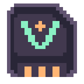

<p align="center">
  
</p>

<h1 align="center">Veldon Game</h1>

<p align="center">
  用 AI 一起做 1,000 款原创游戏，致敬童年。<br>
  Let’s make 1,000 original games with AI, inspired by the games we grew up playing.
</p>

## 目录 · Contents

| 简体中文 | English |
| --- | --- |
| [项目介绍与愿景](#zh-vision) | [About and vision](#en-vision) |
| [主要功能规划](#zh-roadmap) | [Feature roadmap](#en-roadmap) |
| [参与讨论](#zh-discuss) | [Join the discussion](#en-discuss) |
| [版权说明](#zh-rights) | [Copyright and credits](#en-rights) |

<details>
<summary>仓库文件 · Repository files</summary>

```text
.
├── README.md
└── assets/
    └── veldon-game.svg
```

</details>

## 简体中文

<a name="zh-vision"></a>

### 项目介绍与愿景

小时候，放学后的半小时就够两个人传一只手柄，把同一关打上好几遍。Veldon Game 想从这些记忆里找灵感，做一个在浏览器里既能创作、也能玩的游戏工坊。你可以带来一句玩法设想，让 AI 搭出第一版，再和朋友一起试玩，亲手调出想要的手感。

我们的目标是与创作者一起做出 **1,000 款 AI 辅助创作的原创游戏**。希望将来翻开游戏馆，每个编号都能点进去玩，也能看到是谁做的、它来自哪段记忆。

**当前进度**　已有本地工作台原型，可以在浏览器里打开设计文档、查看代码和素材、预览游戏。在线创作、公开发布和游戏馆都在规划中。

<a name="zh-roadmap"></a>

### 主要功能规划

| 方向 | 我们想做成的体验 |
| --- | --- |
| AI 创作与编辑 | 用自己的话写下规则，让 AI 搭出可玩的第一关。在同一工作区修改设计、代码和素材，边玩边调。 |
| 在线试玩与发布 | 为发布的版本生成独立链接。适配触屏的作品可以直接发到朋友的手机上，作者关闭工作台后也能玩。 |
| 千款游戏馆 | 给每款收录的作品一个编号，留下玩法说明、作者署名和创作手记，让玩家能按类型或人数找到下一款游戏。 |
| 引擎与插件 | 先打通 HTML5 游戏的创作和发布，再验证 Godot 的 Web 导出，并评估 Unity 在云端构建网页版本的可行性。 |

<a name="zh-discuss"></a>

### 参与讨论

玩家、开发者、美术和音乐创作者都可以参与。哪怕只记得一个好玩的瞬间，也欢迎把它写下来。比如我们小时候总在同一座断桥前掉下去。如果改成双人合作，一个人铺桥，另一个人举灯探路，这一关会怎么玩？

发帖时可以写下你记得的场景、想改的一条规则，或第一轮试玩最想验证的问题。中英文都欢迎。[到 GitHub Discussions 聊聊](https://github.com/RogerH2018/Veldon-Game/discussions)

<a name="zh-rights"></a>

### 版权说明

Veldon Game 的原创文字、标志和游戏作品由各自权利人享有版权。各作品及其代码、图像、音乐的使用条件，以相应的许可声明为准。分享自己创作或获准发布的素材时，请注明作者、来源和许可。

本地工作台原型基于 OhMyGame 开发，沿用的上游代码遵循 Apache License 2.0。感谢上游贡献者。[OhMyGame](https://github.com/WhiteTowerAI/ohmygame) · [上游许可证](https://github.com/WhiteTowerAI/ohmygame/blob/dce16c80cb514d6cbc3fec65136cf4403f2ea910/LICENSE)

## English

<a name="en-vision"></a>

### About and vision

Half an hour after school was enough to pass a controller back and forth and try the same level a dozen times. Those afternoons are the starting point for Veldon Game, a browser-based workshop where people can make games and play them together. Bring a rule you want to try, use AI to build the first version, then hand it to a friend and tune how it feels.

Our goal is to make **1,000 original, AI-assisted games** with the people who play them. We want every number in the collection to open a playable game and tell you who made it and which memory sparked the idea.

**Current status.** A local prototype already opens design documents, shows code and assets, and previews games in a browser. The hosted studio, public game links, and arcade are planned.

<a name="en-roadmap"></a>

### Feature roadmap

| Area | What we want to build |
| --- | --- |
| AI creation and editing | Describe a rule in your own words and use AI to build a playable first level. Edit the design, code, and assets in one workspace, then play another round. |
| Playtesting and publishing | Give each published version its own link. Send a touch-friendly game to a friend’s phone and let them keep playing after you close the studio. |
| The 1,000-game arcade | Give each entry a number, instructions, creator credits, and a short development note. Help players find their next game by genre or player count. |
| Engines and plugins | Start with creating and publishing HTML5 games. Next, test Godot’s Web export and assess cloud builds for Unity web games. |

<a name="en-discuss"></a>

### Join the discussion

Players, developers, artists, and musicians are welcome. A single memory is enough to start a thread. Maybe you and a friend always fell off the same broken bridge. How would that level play if one of you laid the planks while the other held a lantern to find the way?

Share the moment you remember, a rule you would change, or a question you would like the first playtest to answer. English and Chinese are both welcome. [Join GitHub Discussions](https://github.com/RogerH2018/Veldon-Game/discussions)

<a name="en-rights"></a>

### Copyright and credits

Copyright in Veldon Game’s original writing, logo, and games belongs to the respective rights holders. Each work and its code, art, and music are subject to their stated licenses. When sharing material you created or have permission to publish, please include the creator, source, and license.

The local studio prototype builds on OhMyGame. The reused portions are licensed under the Apache License 2.0. Thanks to the upstream contributors. [OhMyGame](https://github.com/WhiteTowerAI/ohmygame) · [Upstream license](https://github.com/WhiteTowerAI/ohmygame/blob/dce16c80cb514d6cbc3fec65136cf4403f2ea910/LICENSE)
